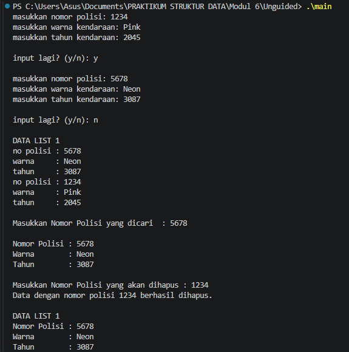

# <h1 align="center">Laporan Praktikum Modul 6 - DOUBLY LINKED LIST (BAGIAN PERTAMA) </h1>
<p align="center">Annisa Berliana Nindya Syah Putri - 109082500166</p>

## Dasar Teori
### A. Konsep Doubly Linked List<br/> 
Doubly Linked List adalah pengembangan dari Singly Linked List. Bedanya, kalau Singly Linked List cuma punya satu pointer (next) yang nunjuk ke elemen depannya, Doubly Linked List punya dua pointer, yaitu next (nunjuk ke elemen depan) dan prev (nunjuk ke elemen belakang). Karena punya dua arah ini, penelusuran datanya bisa dilakukan dari depan ke belakang maupun dari belakang ke depan, yang bikin operasi tertentu jadi lebih efisien.

### B. Struktur dan Komponen Utama
Secara struktur, setiap node di Doubly Linked List terdiri dari tiga bagian: info (data yang disimpan), next (pointer ke node selanjutnya), dan prev (pointer ke node sebelumnya). Selain itu, struktur List-nya sendiri biasanya punya dua pointer utama, yaitu first yang nunjuk ke elemen paling awal, dan last yang nunjuk ke elemen paling akhir. Kalau list-nya kosong, baik first maupun last bakal bernilai Nil (NULL).

### C. Operasi Penyisipan (Insert)
Operasi insert di Doubly Linked List sedikit lebih ribet dibanding Singly Linked List karena kita harus ngatur dua pointer sekaligus (next dan prev) biar rantainya nggak putus.
1. Insert First: Node baru disisipkan di depan. next node baru nunjuk ke first lama, prev dari first lama nunjuk ke node baru, lalu first di-update ke node baru.
2. Insert Last: Node baru disisipkan di belakang. prev node baru nunjuk ke last lama, next dari last lama nunjuk ke node baru, lalu last di-update ke node baru.
3. Insert After: Node baru disisipkan setelah node tertentu (misal node R). Kita harus ngatur next dan prev dari node baru, node R, dan node setelah R secara berurutan.

### Operasi Penghapusan (Delete)
Sama seperti insert, penghapusan juga harus memutus dan menyambungkan dua arah pointer sebelum node di-dealokasi.
1. Delete First: Pointer first digeser ke node kedua. prev dari node kedua (yang jadi first baru) di-set ke Nil.
2. Delete Last: Pointer last digeser ke node kedua dari belakang. next dari node kedua dari belakang (yang jadi last baru) di-set ke Nil.
3. Delete After: Menghapus node setelah node tertentu (R). Pointer next dari R diarahkan ke node setelah node yang dihapus, dan prev dari node setelahnya diarahkan ke R.

## Guided
### Guided 1
#### 1. Doubly List
##### Code Program
###### a. doublylist.h
```C++
#ifndef DOUBLYLIST_H
#define DOUBLYLIST_H
#include <string>
using namespace std;

struct barang {
    string kode;
    string nama;
    int tahun;
};

using infotype = barang;
struct elmlist;
using address = elmlist*;
struct elmlist { infotype info; address prev; address next; };
struct list { address first; address last; };

void CreateList(list &L);
address alokasi(const infotype &x);
void dealokasi(address &P);
void insertFirst(list &L, address P);
void insertLast(list &L, address P);
void insertAfter(list &L, address R, address P);
void insertBefore(list &L, address R, address P);
void printInfo(const list &L);
address findElm(const list &L, const string &kode);
void deleteFirst(list &L, address &P);
void deleteLast(list &L, address &P);
void deleteAfter(list &L, address prec, address &P);
void deleteBefore(list &L, address succ, address &P);
#endif
```

###### b. doublylist.cpp
```C++
#include <iostream>
#include <iomanip>
#include "Doublylist.h"
using namespace std;

void CreateList(list &L) { L.first = nullptr; L.last = nullptr; }

address alokasi(const infotype &x) {
    address P = new elmlist;
    P->info = x;
    P->prev = nullptr; P->next = nullptr;
    return P;
}
void dealokasi(address &P) {
    if (P != nullptr) { delete P; P = nullptr; }
}
void insertFirst(list &L, address P) {
    if (!P) return;
    P->prev = nullptr; P->next = L.first;
    if (L.first) L.first->prev = P;
    else L.last = P;
    L.first = P;
}
void insertLast(list &L, address P) {
    if (!P) return;
    P->next = nullptr; P->prev = L.last;
    if (L.last) L.last->next = P;
    else L.first = P;
    L.last = P;
}

// Menyisipkan P tepat setelah R.
void insertAfter(list &L, address R, address P) {
    if (!R || !P) return;
    P->prev = R;
    P->next = R->next;
    if (R->next) R->next->prev = P;
    else L.last = P;
    R->next = P;
}

// Menyisipkan P tepat sebelum R.
void insertBefore(list &L, address R, address P) {
    if (!R || !P) return;
    P->next = R;
    P->prev = R->prev;
    if (R->prev) R->prev->next = P;
    else L.first = P;
    R->prev = P;
}
void printInfo(const list &L) {
    address P = L.first;
    if (!P) {
        cout << "List kosong.\n";
        return;
    }

    cout << "+--------+------------+-------+\n";
    cout << "| Kode   | Nama       | Tahun |\n";
    cout << "+--------+------------+-------+\n";
    while (P) {
        cout << "| " << left << setw(6) << P->info.kode
             << " | " << setw(10) << P->info.nama
             << " | " << setw(5) << P->info.tahun << " |\n";
        P = P->next;
    }
    cout << "+--------+------------+-------+\n";
}
address findElm(const list &L, const string &kode) {
    address P = L.first;
    while (P) {
        if (P->info.kode == kode) return P;
        P = P->next;
    }
    return nullptr;
}
void deleteFirst(list &L, address &P) {
    if (!L.first) { P = nullptr; return; }
    P = L.first; L.first = P->next;
    if (L.first) L.first->prev = nullptr;
    else L.last = nullptr;
    P->prev = P->next = nullptr;
}
void deleteLast(list &L, address &P) {
    if (!L.last) { P = nullptr; return; }
    P = L.last; L.last = P->prev;
    if (L.last) L.last->next = nullptr;
    else L.first = nullptr;
    P->prev = P->next = nullptr;
}
// Menghapus node tepat setelah prec.
void deleteAfter(list &L, address prec, address &P) {
    P = nullptr;
    if (!prec || !prec->next) return;
    P = prec->next; prec->next = P->next;
    if (P->next) P->next->prev = prec;
    else L.last = prec;
    P->prev = P->next = nullptr;
}
// Menghapus node tepat sebelum succ.
void deleteBefore(list &L, address succ, address &P) {
    P = nullptr;
    if (!succ || !succ->prev) return;
    P = succ->prev; succ->prev = P->prev;
    if (P->prev) P->prev->next = succ;
    else L.first = succ;
    P->prev = P->next = nullptr;
}
```

###### c. main.cpp
```C++
#include <iostream>
#include "Doublylist.h"
using namespace std;

void tampilkanJudul(const string &judul) {
    cout << "\n========================================\n";
    cout << judul << '\n';
    cout << "========================================\n";
}

int main() {
    list L;
    CreateList(L);

    infotype barang1 = {"B001", "Laptop", 2020};
    infotype barang2 = {"B002", "Monitor", 2022};
    infotype barang3 = {"B003", "Keyboard", 2023};
    infotype barang4 = {"B004", "Mouse", 2024};

    address P = nullptr;
    address posisi = nullptr;

    cout << "DEMONSTRASI OPERASI DOUBLY LINKED LIST\n";
    cout << "Data yang digunakan: B001, B002, B003, dan B004\n";

    tampilkanJudul("[1] INSERT FIRST");
    cout << "Menambahkan B002 di awal list.\n";
    insertFirst(L, alokasi(barang2));
    printInfo(L);

    tampilkanJudul("[2] INSERT LAST");
    cout << "Menambahkan B004 di akhir list.\n";
    insertLast(L, alokasi(barang4));
    printInfo(L);

    tampilkanJudul("[3] INSERT AFTER");
    cout << "Menambahkan B003 setelah B002.\n";
    posisi = findElm(L, "B002");
    if (posisi != nullptr) {
        insertAfter(L, posisi, alokasi(barang3));
    }
    printInfo(L);

    tampilkanJudul("[4] INSERT BEFORE");
    cout << "Menambahkan B001 sebelum B002.\n";
    posisi = findElm(L, "B002");
    if (posisi != nullptr) {
        insertBefore(L, posisi, alokasi(barang1));
    }
    printInfo(L);

    tampilkanJudul("[5] FIND ELEMENT");
    cout << "Mencari barang dengan kode B003.\n";
    posisi = findElm(L, "B003");
    if (posisi != nullptr) {
        cout << "Data ditemukan:\n";
        cout << "  Kode  : " << posisi->info.kode << '\n';
        cout << "  Nama  : " << posisi->info.nama << '\n';
        cout << "  Tahun : " << posisi->info.tahun << '\n';
    } else {
        cout << "Data tidak ditemukan.\n";
    }

    tampilkanJudul("[6] DELETE AFTER");
    cout << "Menghapus node setelah B002 (B003).\n";
    posisi = findElm(L, "B002");
    deleteAfter(L, posisi, P);
    if (P != nullptr) {
        cout << "Node yang dihapus: " << P->info.kode << '\n';
        dealokasi(P);
    } else {
        cout << "Tidak ada node yang dapat dihapus.\n";
    }
    printInfo(L);

    tampilkanJudul("[7] DELETE BEFORE");
    cout << "Menghapus node sebelum B004 (B002).\n";
    posisi = findElm(L, "B004");
    deleteBefore(L, posisi, P);
    if (P != nullptr) {
        cout << "Node yang dihapus: " << P->info.kode << '\n';
        dealokasi(P);
    } else {
        cout << "Tidak ada node yang dapat dihapus.\n";
    }
    printInfo(L);

    tampilkanJudul("[8] DELETE FIRST");
    cout << "Menghapus node pertama.\n";
    deleteFirst(L, P);
    if (P != nullptr) {
        cout << "Node yang dihapus: " << P->info.kode << '\n';
        dealokasi(P);
    } else {
        cout << "List kosong, tidak ada node yang dapat dihapus.\n";
    }
    printInfo(L);

    tampilkanJudul("[9] DELETE LAST");
    cout << "Menghapus node terakhir.\n";
    deleteLast(L, P);
    if (P != nullptr) {
        cout << "Node yang dihapus: " << P->info.kode << '\n';
        dealokasi(P);
    } else {
        cout << "List kosong, tidak ada node yang dapat dihapus.\n";
    }
    printInfo(L);

    tampilkanJudul("SELESAI");
    cout << "Kondisi list: "
         << (L.first == nullptr && L.last == nullptr ? "kosong.\n" : "masih berisi data.\n");

    return 0;
}
```
##### Penjelasan Program
Program ini merupakan implementasi struktur data Doubly Linked List menggunakan bahasa C++ untuk mengelola data barang yang terdiri dari kode, nama, dan tahun. Program ini bertujuan untuk mendemonstrasikan berbagai operasi pada Doubly Linked List, mulai dari membuat list kosong, menambahkan data di awal dan akhir, menyisipkan data sebelum dan sesudah node tertentu, mencari data berdasarkan kode barang, hingga menghapus data dari awal, akhir, maupun posisi tertentu. Setiap node saling terhubung menggunakan pointer `prev` dan `next`, sehingga data dapat ditelusuri secara dua arah. Seluruh operasi diuji menggunakan empat data barang, yaitu Laptop, Monitor, Keyboard, dan Mouse. Setelah setiap operasi penambahan dan penghapusan, program menampilkan isi list untuk memperlihatkan perubahan data. Pada akhir program, seluruh node dihapus dan dilakukan pengecekan untuk memastikan list kembali kosong.

## Unguided
### Unguided 1
#### 1. Buatlah ADT Doubly Linked list sebagai berikut di dalam file “Doublylist.h”:
```text
Type infotype : kendaraan <
 nopol : string
 warna : string
 thnBuat : integer
>
Type address : pointer to ElmList
Type ElmList <
 info : infotype
 next :address
 prev : address
>
Type List <
 First : address
 Last : address
>
procedure CreateList( input/output L : List )
function alokasi( x : infotype ) → address
procedure dealokasi(input/output P : address )
procedure printInfo( input L : List )
procedure insertLast(input/output L : List, 
 input P : address )
```
#### Ekspektasi Output
```text
masukkan nomor polisi: D001
masukkan warna kendaraan: hitam
masukkan tahun kendaraan: 90

masukkan nomor polisi: D003
masukkan warna kendaraan: putih
masukkan tahun kendaraan: 70

masukkan nomor polisi: D001
masukkan warna kendaraan: merah
masukkan tahun kendaraan: 80
nomor polisi sudah terdaftar

masukkan nomor polisi: D004
masukkan warna kendaraan: kuning
masukkan tahun kendaraan: 90

DATA LIST 1
no polisi : D004
warna     : kuning
tahun     : 90
no polisi : D003
warna     : putih
tahun     : 70
no polisi : D001
warna     : hitam
tahun     : 90
```

##### a. datakendaraan.h
###### Code Program
```C++
#ifndef DATAKENDARAAN_H
#define DATAKENDARAAN_H

#include <string>
using namespace std;

struct kendaraan {
    string nopol;
    string warna;
    int thnBuat;
};

typedef kendaraan infotype;

struct ElmList;
typedef ElmList* address;

struct ElmList {
    infotype info;
    address next;
    address prev;
};

struct List {
    address First;
    address Last;
};

void createList(List &L);
address alokasi(infotype x);
void dealokasi(address &P);
void printInfo(List L);

void insertLast(List &L, address P);
void insertFirst(List &L, address P);

address findElm(List L, string nopol);

void deleteFirst(List &L, address &P);
void deleteLast(List &L, address &P);
void deleteAfter(List &L, address Prec, address &P);

#endif
```
#### 2. Carilah elemen dengan nomor polisi D001 dengan membuat fungsi baru.
#### fungsi findElm( L : List, x : infotype ) : address
#### Ekspektasi Output:
```text
Masukkan Nomor Polisi yang dicari  : D001

Nomor Polisi : D001
Warna        : hitam
Tahun        : 90
```
##### b. datakendaraan.cpp
###### Code Program
```C++
#include <iostream>
#include "datakendaraan.h"
using namespace std;

void createList(List &L) {
    L.First = nullptr;
    L.Last = nullptr;
}

address alokasi(infotype x) {
    address P = new ElmList;
    P->info = x;
    P->next = nullptr;
    P->prev = nullptr;
    return P;
}

void dealokasi(address &P) {
    if (P != nullptr) {
        delete P;
        P = nullptr;
    }
}

void insertLast(List &L, address P) {
    if (P == nullptr) return;

    if (L.First == nullptr) {
        L.First = P;
        L.Last = P;
    } else {
        P->prev = L.Last;
        L.Last->next = P;
        L.Last = P;
    }
}

void insertFirst(List &L, address P) {
    if (P == nullptr) return;

    if (L.First == nullptr) {
        L.First = P;
        L.Last = P;
    } else {
        P->next = L.First;
        L.First->prev = P;
        L.First = P;
    }
}

void printInfo(List L) {
    address P = L.First;

    while (P != nullptr) {
        cout << "no polisi : " << P->info.nopol << endl;
        cout << "warna     : " << P->info.warna << endl;
        cout << "tahun     : " << P->info.thnBuat << endl;

        P = P->next;
    }
}

address findElm(List L, string nopol) {
    address P = L.First;

    while (P != nullptr) {
        if (P->info.nopol == nopol) {
            return P;
        }
        P = P->next;
    }

    return nullptr;
}

void deleteFirst(List &L, address &P) {
    P = nullptr;

    if (L.First == nullptr) return;

    P = L.First;
    L.First = P->next;

    if (L.First != nullptr) {
        L.First->prev = nullptr;
    } else {
        L.Last = nullptr;
    }

    P->next = nullptr;
    P->prev = nullptr;
}

void deleteLast(List &L, address &P) {
    P = nullptr;

    if (L.Last == nullptr) return;

    P = L.Last;
    L.Last = P->prev;

    if (L.Last != nullptr) {
        L.Last->next = nullptr;
    } else {
        L.First = nullptr;
    }

    P->next = nullptr;
    P->prev = nullptr;
}

void deleteAfter(List &L, address Prec, address &P) {
    P = nullptr;

    if (Prec == nullptr || Prec->next == nullptr) return;

    P = Prec->next;
    Prec->next = P->next;

    if (P->next != nullptr) {
        P->next->prev = Prec;
    } else {
        L.Last = Prec;
    }

    P->next = nullptr;
    P->prev = nullptr;
}
```

#### 3. Hapus elemen dengan nomor polisi D003 dengan procedure delete.
- procedure deleteFirst( input/output L : List, 
 P : address )
- procedure deleteLast( input/output L : List, 
 P : address )
- procedure deleteAfter( input Prec : address, 
 input/output P : address )
#### Ekspektasi Output:
```text
Masukkan Nomor Polisi yang akan dihapus : D003
Data dengan nomor polisi D003 berhasil dihapus.

DATA LIST 1
Nomor Polisi : D004
Warna        : kuning
Tahun        : 90
Nomor Polisi : D001
Warna        : hitam
Tahun        : 90
```
##### c. main.cpp
###### Code Program
```C++
#include <iostream>
#include "datakendaraan.h"
using namespace std;

int main() {
    List L;
    createList(L);

    string nopol, warna;
    int tahun;
    char inputLagi;

    do {
        cout << "masukkan nomor polisi: ";
        cin >> nopol;

        address cek = findElm(L, nopol);

        if (cek != nullptr) {
            cout << "nomor polisi sudah terdaftar" << endl;
            cout << endl;
            continue;
        }

        cout << "masukkan warna kendaraan: ";
        cin >> warna;

        cout << "masukkan tahun kendaraan: ";
        cin >> tahun;
        cout << endl;

        infotype dataBaru;
        dataBaru.nopol = nopol;
        dataBaru.warna = warna;
        dataBaru.thnBuat = tahun;

        address P = alokasi(dataBaru);
        insertFirst(L, P);

        cout << "input lagi? (y/n): ";
        cin >> inputLagi;
        cout << endl;

    } while (inputLagi == 'y' || inputLagi == 'Y');

    cout << "DATA LIST 1" << endl;
    printInfo(L);
    cout << endl;

    string cariNopol;

    cout << "Masukkan Nomor Polisi yang dicari  : ";
    cin >> cariNopol;

    address hasilCari = findElm(L, cariNopol);

    if (hasilCari != nullptr) {
        cout << endl;
        cout << "Nomor Polisi : " << hasilCari->info.nopol << endl;
        cout << "Warna        : " << hasilCari->info.warna << endl;
        cout << "Tahun        : " << hasilCari->info.thnBuat << endl;
    } else {
        cout << "Data tidak ditemukan!" << endl;
    }

    cout << endl;

    string hapusNopol;

    cout << "Masukkan Nomor Polisi yang akan dihapus : ";
    cin >> hapusNopol;

    address P = findElm(L, hapusNopol);

    if (P != nullptr) {
        address temp = nullptr;

        if (P == L.First) {
            deleteFirst(L, temp);
        } else if (P == L.Last) {
            deleteLast(L, temp);
        } else {
            deleteAfter(L, P->prev, temp);
        }

        dealokasi(temp);

        cout << "Data dengan nomor polisi " << hapusNopol
             << " berhasil dihapus." << endl;
    } else {
        cout << "Data tidak ditemukan!" << endl;
    }

    cout << endl;

    cout << "DATA LIST 1" << endl;

    address Q = L.First;

    while (Q != nullptr) {
        cout << "Nomor Polisi : " << Q->info.nopol << endl;
        cout << "Warna        : " << Q->info.warna << endl;
        cout << "Tahun        : " << Q->info.thnBuat << endl;

        Q = Q->next;
    }

    return 0;
}
```

##### Output Unguided 1


##### Penjelasan Program
Program ini terdiri dari tiga file, yaitu `datakendaraan.h`, `datakendaraan.cpp`, dan `main.cpp`. File `datakendaraan.h` berisi deklarasi struktur data Doubly Linked List untuk menyimpan informasi kendaraan berupa nomor polisi, warna, dan tahun pembuatan, serta deklarasi prosedur dan fungsi yang digunakan. File `datakendaraan.cpp` berisi implementasi fungsi untuk membuat list, mengalokasikan dan menghapus elemen, menambahkan data di awal maupun akhir list, menampilkan data, mencari kendaraan, serta menghapus elemen berdasarkan posisinya. Sementara itu, `main.cpp` berfungsi sebagai program utama yang mengatur proses input data kendaraan, pengecekan nomor polisi duplikat, pencarian data berdasarkan nomor polisi, penghapusan data, dan menampilkan kembali data kendaraan yang tersisa.

## Kesimpulan
Berdasarkan praktikum yang telah dilakukan, dapat disimpulkan bahwa program Doubly Linked List dapat digunakan untuk mengelola data kendaraan yang terdiri dari nomor polisi, warna, dan tahun pembuatan. Melalui program ini, pengguna dapat menambahkan data, memeriksa nomor polisi duplikat, mencari data kendaraan, serta menghapus elemen berdasarkan posisinya. Penggunaan pointer `next` dan `prev` memungkinkan setiap elemen saling terhubung ke elemen sebelum dan sesudahnya, sehingga proses pengelolaan data dapat dilakukan dengan lebih fleksibel.

## Referensi
Laboratorium Informatika, Fakultas Informatika, Telkom University. (t.t.). Modul 6: Doubly linked list (bagian pertama). Dalam Modul praktikum struktur data (hlm. 51–58). Telkom University.