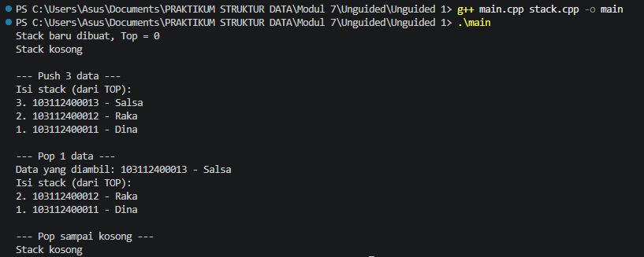
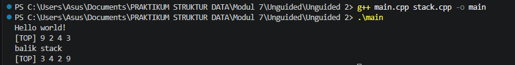
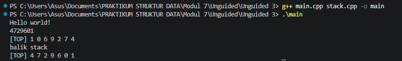

# <h1 align="center">Laporan Praktikum Modul 7 - STACK </h1>
<p align="center">Annisa Berliana Nindya Syah Putri - 109082500166 </p>

## Dasar Teori
Stack merupakan salah satu bentuk struktur data yang prinsip operasinya seperti tumpukan. Seperti halnya tumpukan benda, elemen yang dapat diambil lebih dahulu adalah elemen yang berada paling atas. Prinsip ini dikenal dengan istilah LIFO (Last In First Out). Komponen penyusun stack pada dasarnya sama dengan komponen pada singly linked list, hanya saja akses pada stack dibatasi pada bagian awal stack saja.

### A. Konsep Dasar Stack
### 1. Komponen dan Deklarasi Stack
Bentuk stack mirip dengan list linear, yaitu terdiri dari elemen-elemen yang saling terkait. Komponen utama yang berfungsi untuk mengakses data dalam stack hanyalah elemen paling awal yang disebut "Top". Dalam stack hanya terdapat Top, dan tipe address yang digunakan sama dengan tipe elemen pada list lainnya. Pada representasi pointer, setiap elemen (elmStack) memiliki field info dan next, sedangkan struktur stack hanya menyimpan satu pointer yaitu Top. Stack kosong digambarkan dengan Top yang bernilai Nil.

### 2. Primitif pada Stack
Primitif pada stack pada dasarnya sama dengan primitif list lainnya, tetapi jumlahnya lebih sedikit karena operasi hanya dilakukan terhadap elemen paling atas. Primitif tersebut meliputi createStack(), isEmpty(), alokasi(), dealokasi(), fungsi-fungsi pencarian, dan fungsi primitif lainnya. Seperti pada model list yang lain, primitif disimpan dalam file *.c dan *.h.

### B. Operasi pada Stack
Terdapat dua operasi utama pada stack, yaitu penyisipan (Push) dan pengambilan (Pop).
### 1. Push
Push adalah operasi menyisipkan elemen ke dalam tumpukan data, dan fungsinya sama dengan insert first pada list biasa. Pada representasi pointer, prosesnya dimulai dengan mengalokasikan elemen baru (`P = alokasi(X)`) dengan next bernilai Nil, kemudian next elemen tersebut diarahkan ke Top lama (`P->next = S.Top`), dan terakhir Top dipindahkan ke elemen baru (`S.Top = P`).
### 2. Pop
Pop adalah operasi pengambilan data pada stack yang mirip dengan delete first pada list linear, karena elemen yang pertama kali diakses adalah elemen paling atas. Langkahnya yaitu menyimpan Top ke variabel bantu (`P = S.Top`), memindahkan Top ke elemen berikutnya (`S.Top = (S.Top)->next`), lalu mengembalikan elemen yang disimpan tersebut.

### C. Representasi Stack dengan Tabel (Array)
Pada prinsipnya representasi tabel sama dengan representasi pointer. Perbedaannya terletak pada deklarasi struktur datanya yang memakai array berindeks, sehingga jumlah tumpukan menjadi terbatas. Hal-hal penting pada representasi ini:
- Indeks maksimum stack ditandai dengan Imax, dan stack dinyatakan kosong apabila Top = 0.
- Push dilakukan dengan menggeser indeks Top ke indeks berikutnya (Top = Top + 1), lalu data disimpan pada posisi tersebut.
- Pop dilakukan dengan menyimpan S.Info[Top] ke variabel bantu kemudian Top = Top - 1, tanpa menghilangkan info pada indeks Top sebelumnya.
- Primitif pada representasi tabel sama dengan representasi pointer, perbedaannya hanya pada manajemen memori yang tidak diperlukan pada representasi tabel.
- Contoh ADT stack representasi tabel pada modul menggunakan struct infotype berisi nim dan nama, serta struct Stack berisi array info berukuran 10 dan variabel Top.

## Guided 
### 1. Stack
### a. stack.h
```C++
#ifndef STACK_H_INCLUDED
#define STACK_H_INCLUDED

#include <iostream>
using namespace std;

const int BATAS = 10;

struct infotype {
    char nim[20];
    char nama[20];
};

struct Stack {
    infotype info[BATAS];
    int Top;
};

int isEmpty(Stack S);
void createStack(Stack &S);
void push(Stack &S, infotype X);
void pop(Stack &S, infotype &X);
void viewStack(Stack S);

#endif
```

### b. stack.cpp
```C++
#include "stack.h"

int isEmpty(Stack S) {
    return (S.Top == 0) ? 0 : 1;
}

void createStack(Stack &S) {
    S.Top = 0;
}

void push(Stack &S, infotype X) {
    if (S.Top == BATAS) {
        cout << "Stack penuh, data tidak dapat ditambahkan" << endl;
        return;
    }
    S.Top++;
    S.info[S.Top - 1] = X;
}

void pop(Stack &S, infotype &X) {
    if (isEmpty(S) == 0) {
        cout << "Stack kosong, tidak ada data yang dapat diambil" << endl;
        return;
    }
    X = S.info[S.Top - 1];
    S.Top--;
}

void viewStack(Stack S) {
    if (isEmpty(S) == 0) {
        cout << "Stack kosong" << endl;
        return;
    }
    cout << "Isi stack (dari TOP):" << endl;
    for (int i = S.Top; i > 0; i--) {
        cout << i << ". " << S.info[i - 1].nim << " - "
             << S.info[i - 1].nama << endl;
    }
}
```

### c. main.cpp
```C++
#include <iostream>
#include <cstring>
#include "stack.h"
using namespace std;

int main() {
    Stack S;
    infotype data, hasil;

    const char *daftarNim[]  = {"103112400011", "103112400012", "103112400013"};
    const char *daftarNama[] = {"Dina", "Raka", "Salsa"};

    createStack(S);
    cout << "Stack baru dibuat, Top = " << S.Top << endl;
    viewStack(S);

    cout << endl << "--- Push 3 data ---" << endl;
    for (int i = 0; i < 3; i++) {
        strcpy(data.nim, daftarNim[i]);
        strcpy(data.nama, daftarNama[i]);
        push(S, data);
    }
    viewStack(S);

    cout << endl << "--- Pop 1 data ---" << endl;
    pop(S, hasil);
    cout << "Data yang diambil: " << hasil.nim << " - " << hasil.nama << endl;
    viewStack(S);

    cout << endl << "--- Pop sampai kosong ---" << endl;
    while (isEmpty(S) != 0) {
        pop(S, hasil);
    }
    viewStack(S);

    return 0;
}
```

###### Penjelasan Program
Program ini mengimplementasikan stack dengan representasi tabel yang kapasitasnya dibatasi oleh konstanta `BATAS` (10 elemen). Setiap elemen berupa struct `infotype` yang menyimpan NIM dan nama mahasiswa. Variabel `Top` berperan sebagai penghitung sekaligus penunjuk elemen teratas: `push` menambah `Top` lalu menyimpan data pada posisinya, sedangkan `pop` membaca data teratas kemudian mengurangi `Top`. Fungsi `isEmpty` mengembalikan 0 saat stack kosong (mengikuti ketentuan pada modul), dan `viewStack` mencetak isi dari posisi teratas ke dasar. Pada program utama, tiga data dimasukkan menggunakan perulangan dari array konstanta, satu data diambil, lalu `while` dipakai untuk mengosongkan stack sampai `isEmpty` menandakan kosong.

## Unguided 
### 1. Buatlah ADT Stack menggunakan ARRAY sebagai berikut di dalam file “stack.h”:  
```text
Type infotype : integer 
Type Stack < 
    info : array [20] of integer 
    top : integer 
>
procedure CreateStack( input/output S : Stack ) 
procedure push(input/output S : Stack,
    input x : infotype)
function pop(input/output t S : Stack )
      → infotype 
procedure printInfo( input S : Stack )
procedure balikStack(input/output S : 
    Stack )
```
### Buatlah implementasi ADT Stack menggunakan Array pada file “stack.cpp” dan “main.cpp” 
```text
int main() 
{  
    cout << "Hello world!" << endl;  
    Stack S;  
    createStack(S);  
    Push(S,3);  
    Push(S,4);  
    Push(S,8);  
    pop(S)  
    Push(S,2);  
    Push(S,3);  
    pop(S);  
    Push(S,9);  
    printInfo(S);  
    cout<<"balik stack"<<endl;  
    balikStack(S);  
    printInfo(S);  
    return 0; 
} 
``` 
### a. stack.h
```C++
#ifndef STACK_H
#define STACK_H

typedef int infotype;

const int KAPASITAS = 20;

struct Stack {
    infotype info[KAPASITAS];
    int top;
};

void createStack(Stack &S);
void push(Stack &S, infotype x);
infotype pop(Stack &S);
void printInfo(Stack S);
void balikStack(Stack &S);

#endif
```
### b. stack.cpp
```C++
#include "stack.h"
#include <iostream>
using namespace std;

void createStack(Stack &S) {
    S.top = 0;
}

void push(Stack &S, infotype x) {
    if (S.top >= KAPASITAS) {
        cout << "Stack penuh" << endl;
        return;
    }
    S.info[S.top++] = x;
}

infotype pop(Stack &S) {
    if (S.top <= 0) {
        cout << "Stack kosong" << endl;
        return -1;
    }
    return S.info[--S.top];
}

void printInfo(Stack S) {
    if (S.top == 0) {
        cout << "Stack kosong" << endl;
        return;
    }
    cout << "[TOP]";
    for (int i = S.top - 1; i >= 0; i--) {
        cout << " " << S.info[i];
    }
    cout << endl;
}

void balikStack(Stack &S) {
    infotype sementara[KAPASITAS];
    int n = S.top;
    for (int i = 0; i < n; i++) {
        sementara[i] = pop(S);
    }
    for (int i = 0; i < n; i++) {
        push(S, sementara[i]);
    }
}
```
### c. main.cpp
```C++
#include <iostream>
#include "stack.h"
using namespace std;

int main() {
    cout << "Hello world!" << endl;

    Stack S;
    createStack(S);

    push(S, 3);
    push(S, 4);
    push(S, 8);
    pop(S);
    push(S, 2);
    push(S, 3);
    pop(S);
    push(S, 9);

    printInfo(S);

    cout << "balik stack" << endl;
    balikStack(S);
    printInfo(S);

    return 0;
}
```
### Output Unguided 1:

##### Output 1


###### Penjelasan Program
Program ini membangun stack berbasis array dengan kapasitas 20 elemen yang ditentukan oleh konstanta `KAPASITAS`. Fungsi `push` menyimpan nilai pada indeks `top` lalu menaikkannya, sedangkan `pop` menurunkan `top` terlebih dahulu kemudian mengembalikan nilai di indeks tersebut; keduanya dilengkapi pengecekan stack penuh/kosong. `printInfo` menampilkan isi stack dari TOP ke bawah. Untuk `balikStack`, seluruh elemen di-pop satu per satu ke array sementara, lalu di-push kembali sesuai urutan hasil pop sehingga posisi elemen menjadi terbalik. Dari urutan operasi pada `main`, isi akhir stack adalah 3, 4, 2, 9 dari dasar ke atas, sehingga tercetak `[TOP] 9 2 4 3` dan setelah dibalik menjadi `[TOP] 3 4 2 9`.

### 2. Tambahkan prosedur pushAscending( in/out S : Stack, in x : integer)
```
int main() 
{  
    cout << "Hello world!" << endl;  
    Stack S;  
    createStack(S);  
    pushAscending(S,3); 
    pushAscending(S,4); 
    pushAscending(S,8); 
    pushAscending(S,2); 
    pushAscending(S,3); 
    pushAscending(S,9); 
    printInfo(S); 
    cout<<"balik stack"<<endl; 
    balikStack(S); 
    printInfo(S); 
    return 0; 
}  
``` 

### a. stack.h
```C++
#ifndef STACK_H
#define STACK_H

typedef int infotype;

const int KAPASITAS = 20;

struct Stack {
    infotype info[KAPASITAS];
    int top;
};

void createStack(Stack &S);
void push(Stack &S, infotype x);
infotype pop(Stack &S);
void printInfo(Stack S);
void balikStack(Stack &S);
void pushAscending(Stack &S, infotype x);

#endif
```
### b. stack.cpp
```C++
#include "stack.h"
#include <iostream>
using namespace std;

void createStack(Stack &S) {
    S.top = 0;
}

void push(Stack &S, infotype x) {
    if (S.top >= KAPASITAS) {
        cout << "Stack penuh" << endl;
        return;
    }
    S.info[S.top++] = x;
}

infotype pop(Stack &S) {
    if (S.top <= 0) {
        cout << "Stack kosong" << endl;
        return -1;
    }
    return S.info[--S.top];
}

void printInfo(Stack S) {
    if (S.top == 0) {
        cout << "Stack kosong" << endl;
        return;
    }
    cout << "[TOP]";
    for (int i = S.top - 1; i >= 0; i--) {
        cout << " " << S.info[i];
    }
    cout << endl;
}

void balikStack(Stack &S) {
    infotype sementara[KAPASITAS];
    int n = S.top;
    for (int i = 0; i < n; i++) {
        sementara[i] = pop(S);
    }
    for (int i = 0; i < n; i++) {
        push(S, sementara[i]);
    }
}

void pushAscending(Stack &S, infotype x) {
    if (S.top == 0 || S.info[S.top - 1] <= x) {
        push(S, x);
        return;
    }
    infotype atas = pop(S);
    pushAscending(S, x);
    push(S, atas);
}
```
### c. main.cpp
```C++
#include <iostream>
#include "stack.h"
using namespace std;

int main() {
    cout << "Hello world!" << endl;

    Stack S;
    createStack(S);

    pushAscending(S, 3);
    pushAscending(S, 4);
    pushAscending(S, 8);
    pushAscending(S, 2);
    pushAscending(S, 3);
    pushAscending(S, 9);

    printInfo(S);

    cout << "balik stack" << endl;
    balikStack(S);
    printInfo(S);

    return 0;
}
```
### Output Unguided 2:


###### Penjelasan Program
Pada program ini `pushAscending` dibuat secara rekursif. Jika stack kosong atau elemen teratas tidak lebih besar dari nilai baru, nilai langsung di-push. Jika tidak, elemen teratas di-pop dan disimpan sementara, prosedur memanggil dirinya sendiri untuk mencari posisi yang tepat, lalu elemen yang tadi disimpan di-push kembali saat rekursi selesai. Dengan begitu stack selalu terurut menaik dari dasar ke atas dan nilai terbesar berada di TOP, sehingga hasilnya `[TOP] 9 8 4 3 3 2`, dan setelah `balikStack` menjadi `[TOP] 2 3 3 4 8 9`.

### 3. Tambahkan prosedur getInputStream( in/out S : Stack ). Prosedur akan terus membaca dan menerima input user dan memasukkan setiap input ke dalam stack hingga user menekan tombol enter. Contoh: gunakan cin.get() untuk mendapatkan inputan user.
```
int main() 
{ 
    cout << "Hello world!" << endl; 
    Stack S; 
    createStack(S); 
    getInputStream(S); 
    printInfo(S); 
    cout<<"balik stack"<<endl; 
    balikStack(S); 
    printInfo(S); 
    return 0; 
} 
```

### a. stack.h
```C++
#ifndef STACK_H
#define STACK_H

typedef int infotype;

const int KAPASITAS = 20;

struct Stack {
    infotype info[KAPASITAS];
    int top;
};

void createStack(Stack &S);
void push(Stack &S, infotype x);
infotype pop(Stack &S);
void printInfo(Stack S);
void balikStack(Stack &S);
void getInputStream(Stack &S);

#endif
```
### b. stack.cpp
```C++
#include "stack.h"
#include <iostream>
#include <cctype>
using namespace std;

void createStack(Stack &S) {
    S.top = 0;
}

void push(Stack &S, infotype x) {
    if (S.top >= KAPASITAS) {
        cout << "Stack penuh" << endl;
        return;
    }
    S.info[S.top++] = x;
}

infotype pop(Stack &S) {
    if (S.top <= 0) {
        cout << "Stack kosong" << endl;
        return -1;
    }
    return S.info[--S.top];
}

void printInfo(Stack S) {
    if (S.top == 0) {
        cout << "Stack kosong" << endl;
        return;
    }
    cout << "[TOP]";
    for (int i = S.top - 1; i >= 0; i--) {
        cout << " " << S.info[i];
    }
    cout << endl;
}

void balikStack(Stack &S) {
    infotype sementara[KAPASITAS];
    int n = S.top;
    for (int i = 0; i < n; i++) {
        sementara[i] = pop(S);
    }
    for (int i = 0; i < n; i++) {
        push(S, sementara[i]);
    }
}

void getInputStream(Stack &S) {
    int c = cin.get();
    while (c != '\n' && c != EOF) {
        if (isdigit(c)) {
            push(S, c - '0');
        }
        c = cin.get();
    }
}
```
### c. main.cpp
```C++
#include <iostream>
#include "stack.h"
using namespace std;

int main() {
    cout << "Hello world!" << endl;

    Stack S;
    createStack(S);

    getInputStream(S);
    printInfo(S);

    cout << "balik stack" << endl;
    balikStack(S);
    printInfo(S);

    return 0;
}
```
### Output Unguided 3:


###### Penjelasan Program
Prosedur `getInputStream` membaca input karakter demi karakter memakai `cin.get()` dalam perulangan `while` yang berhenti ketika menemukan tombol Enter (`'\n'`) atau akhir input (`EOF`). Setiap karakter yang merupakan angka (dicek dengan `isdigit`) diubah menjadi nilai integer dengan mengurangkan `'0'`, lalu di-push ke stack; karakter selain angka diabaikan. Contohnya, input `4729601` menghasilkan `[TOP] 1 0 6 9 2 7 4` karena angka terakhir yang dimasukkan berada di TOP (sesuai LIFO), dan setelah `balikStack` urutannya menjadi `[TOP] 4 7 2 9 6 0 1`.

## Kesimpulan
Berdasarkan praktikum Modul 7, dapat disimpulkan bahwa stack adalah struktur data yang bekerja dengan prinsip LIFO (Last In First Out), di mana penyisipan (push) dan pengambilan (pop) elemen hanya dilakukan pada satu ujung, yaitu Top. Representasi tabel (array) membuat implementasi stack menjadi sederhana karena cukup mengatur indeks Top tanpa manajemen memori, dengan konsekuensi kapasitas yang terbatas. Pada latihan, ADT stack dikembangkan dengan beberapa prosedur tambahan: `balikStack` untuk membalik isi stack dengan memanfaatkan operasi pop dan push, `pushAscending` untuk menjaga elemen tetap terurut menaik menggunakan rekursi, serta `getInputStream` untuk memasukkan input pengguna ke dalam stack hingga Enter ditekan. Ketiganya menunjukkan bahwa dengan operasi dasar push dan pop saja, stack dapat dipakai menyelesaikan berbagai persoalan pengolahan data secara berurutan.

## Referensi
Informatics Laboratory, Fakultas Informatika, Telkom University. (t.t.). Modul 7: Stack. Modul Praktikum Struktur Data.